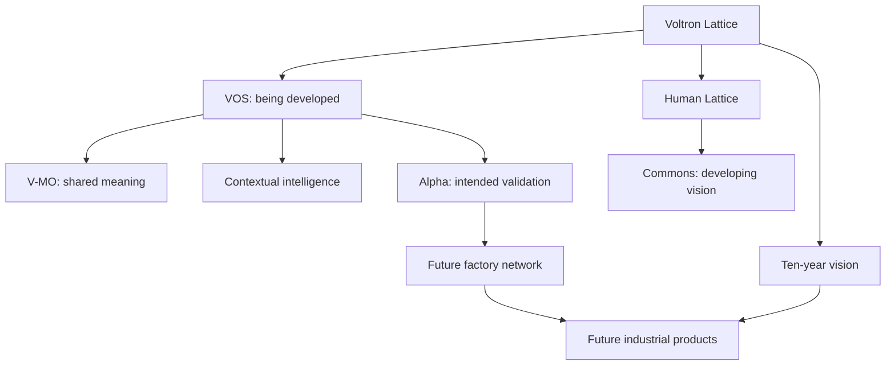

# Knowledge graph: visual overview

Arrows describe conceptual relationships and future direction. Consult [typed relationships](relations.md) for status and sources and [nodes](nodes.md) for file mappings.

The graph supports topic discovery, not proof of deployment. Production availability is always answered from current approved evidence.
